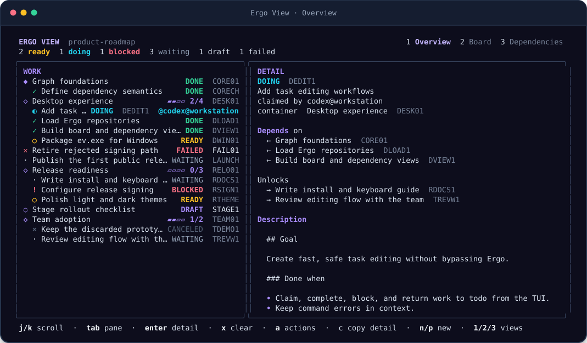
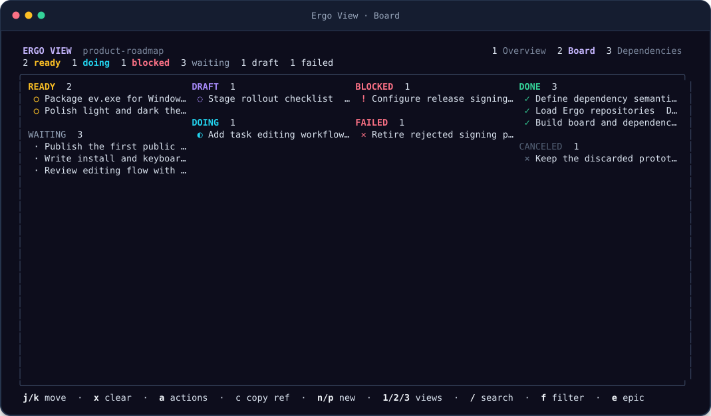
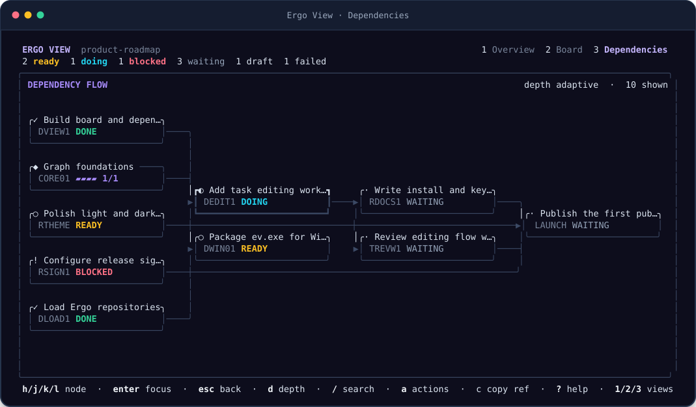

# Ergo View

Ergo View is a responsive terminal companion for [Ergo](https://github.com/sandover/ergo). It turns local epics, tasks, dependencies, journals, and activity into a fast Bubble Tea interface while keeping Ergo itself in charge of every change.



## Install

Ergo View requires Go 1.25.8 or newer when building from source and a released Ergo 1–6 executable available as `ergo` on `PATH` for task actions. Ergo 6 is recommended for draft staging, failed outcomes, and independent results.

On macOS with Homebrew:

```sh
brew install --cask jamestjsp/tap/ergoview
```

On Windows with WinGet:

```powershell
winget install --id JamesJoseph.ErgoView --exact
```

Or install from source with Go:

```sh
go install github.com/jamestjsp/ergoview/cmd/ev@latest
```

Tagged releases also provide `ev` archives for macOS and Linux and `ev.exe` ZIP files for Windows. Download the archive for your platform from [Releases](https://github.com/jamestjsp/ergoview/releases), extract it, and put the executable on `PATH`. New WinGet packages become available after Microsoft validates and merges their catalog submission.

Run `ev` anywhere inside an Ergo project:

```sh
cd my-project
ev
```

Use `--dir` to start discovery elsewhere, `--agent` to set the identity used by claims, or `--ergo` when the Ergo executable is not on `PATH`:

```sh
ev --dir ../my-project --agent codex@workstation
ev --ergo /opt/tools/ergo
```

Ergo View walks upward from the starting path to find `.ergo`. It reads the current `.ergo/backlog.jsonl` format, the older `.ergo/plans.jsonl` format, the legacy `.ergo/events.jsonl` filename, and the shared `.ergo/journal.jsonl` introduced by Ergo 5. Released standalone events, transaction batches, and compacted snapshots are all supported.

## Views

- **Overview** pairs the task outline with rendered Markdown, dependency context, lifecycle activity, and attached results. Narrow terminals switch between the outline and detail panes.
- **Board** keeps ready, waiting, doing, blocked, done, and canceled work distinct.
- **Dependencies** renders the selected task’s lineage as an interactive terminal graph. Arrows flow from prerequisites toward the work they unlock; task cards carry state and epic membership, while double-border epic cards carry completion progress. The layout automatically chooses horizontal or vertical flow and summarizes branches that do not fit.





All views share selection, fuzzy search, state filtering, created-time sorting, and container focus. Ergo View reloads external changes once per second without losing the selected task.

Press `c` or click the copy control in the footer to copy the selected task or container as `ID  Title`. When the Overview detail pane is focused, the same control copies the whole visible detail as clean Markdown.

In the dependency graph, use the arrow keys or `h`/`j`/`k`/`l` to move spatially between cards. `Enter` makes the selected card the exploration focus, `Esc` returns to the previous focus, and `d` cycles direct, adaptive, and full-lineage depth. The adaptive default spends the available terminal cells on the nearest upstream and downstream context; selecting an overflow card reveals more. Mouse clicks select cards directly.

## Interact

Press `n` to create a task, `p` to create an epic plan, or `a` to open actions for the selected task. Ergo View detects the selected Ergo executable once and maps each action to that release generation. Task actions can:

- create ordinary work or stage draft work with Ergo 6;
- claim or resume work;
- mark work done, failed, blocked, canceled, or return it to todo;
- record independent results with Ergo 5 and newer;
- rename or replace the Markdown body;
- move a task into an epic or back to the root;
- add or remove a dependency.

Lifecycle actions accept an optional message. Ergo 1–4 can attach a result path during a lifecycle action; Ergo 5–6 expose results as their own summary-and-optional-file action. Multiline fields use `Ctrl+S` to continue. Destructive or state-reopening operations ask for confirmation.

Ergo View never edits the event log. It invokes the official Ergo CLI for every mutation, then reloads the resulting snapshot. Errors stay in the dialog so input is not lost.

## Keys

| Key | Action |
| --- | --- |
| `j` / `k`, `↑` / `↓` | Move selection or scroll details |
| `h` / `l`, `←` / `→` | Move across dependency graph nodes |
| `home` / `G` | First / last task |
| `page up` / `page down` | Move one page |
| `1` / `2` / `3` | Overview / board / dependencies |
| `/` | Fuzzy search ID, title, body, or agent |
| `f` | Cycle state filter |
| `s` | Cycle created-time sort: default, newest, oldest |
| `e` | Focus the selected container |
| `x` | Clear search and filters |
| `tab` / `enter` (overview) | Switch or focus overview panes |
| `enter` / `esc` (graph) | Focus graph node / return to previous graph focus |
| `d` | Cycle direct / adaptive / lineage graph depth |
| `c` | Copy the selected ID and title, or the focused detail as Markdown |
| `a` | Open selected task actions |
| `n` / `p` | New task / container plan |
| `?` | Toggle complete in-app help |
| `q` / `Ctrl+C` | Quit |

Mouse selection and wheel scrolling are also supported.

## Compatibility

Ergo View preserves released Ergo storage and command compatibility by generation:

- **Ergo 1–3:** `events.jsonl` and `plans.jsonl`, standalone events, JSON task creation, `plan`, and `release`.
- **Ergo 4:** `backlog.jsonl`, atomic transaction records, compacted snapshot blocks, title-based task and epic creation, and `release`.
- **Ergo 5:** the shared journal, failed outcomes, explicit `result` records, and `release`.
- **Ergo 6:** draft staging and `open` in place of `release`.

Draft work is visible but never ready. Failed work is finished and releases dependencies while remaining distinct from successful completion. A completed epic is failed when any child failed, canceled when none failed and at least one child was canceled, and done otherwise.

Reading tolerates one partially written final backlog or journal record. Malformed complete records, unsupported versions, invalid compacted-snapshot ordering, and checksum mismatches are reported with their source path and line. Ergo View never rewrites these files.

Set `NO_COLOR=1` for terminals that should not receive color styling. The executable is named `ev` on macOS and Linux and `ev.exe` on Windows. Release builds cover AMD64 and ARM64 for all three operating systems.

## Develop

```sh
git clone --recurse-submodules https://github.com/jamestjsp/ergoview.git
cd ergoview
go test -race ./...
go vet ./...
go build -o ev ./cmd/ev
```

Existing clones can initialize the pinned upstream compatibility reference with `git submodule update --init`. The `upstream/ergo` submodule points to the original `sandover/ergo` v6.0.5 release and supplies immutable released-major fixtures for regression tests; Ergo View does not import Ergo internals or ship the submodule in binary archives.

Render fixtures and documentation images are reproducible:

```sh
UPDATE_GOLDEN=1 go test ./internal/ui -run 'TestRenderSnapshots|TestDocumentationScreenshots'
```

The data adapter is read-only and UI-independent. The action layer exposes intent-level Ergo operations and owns CLI-generation adaptation, which keeps the UI version-neutral without duplicating Ergo's mutation rules.

## License

[MIT](LICENSE)
